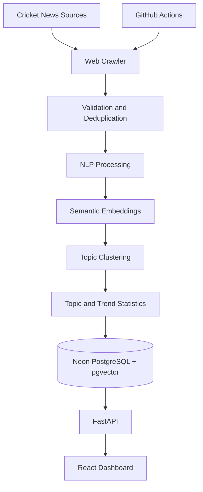

<h1 align="center">T20 Cricket News Intelligence System</h1>

<p align="center">
  An end-to-end NLP system that collects T20 cricket news, discovers related topics, and visualises news trends through an interactive dashboard.
</p>

<p align="center">
  
  
  
  
  
  
  
</p>

---

## About the Project

The **T20 Cricket News Intelligence System** collects cricket news from accessible sources and analyses articles to identify related topics and changing news trends. It combines web crawling, natural language processing, semantic embeddings, and topic clustering in a pipeline supported by a web dashboard.

## Key Features

- Collects cricket news from accessible sources.
- Filters articles for T20 relevance and removes duplicates.
- Extracts entities, keywords, and sentiment signals.
- Generates semantic embeddings for news articles.
- Discovers groups of related articles using HDBSCAN.
- Compares HDBSCAN with a K-Means baseline.
- Tracks topic activity and trends over time.
- Presents results through a React dashboard backed by a FastAPI API.
- Supports automated pipeline runs through GitHub Actions.

## System Architecture



## Technology Stack

| Component | Technologies |
|---|---|
| Backend API | Python, FastAPI, Uvicorn |
| Frontend | React, Vite, React Router, Recharts |
| Database | Neon PostgreSQL, pgvector, psycopg |
| Web crawling | Requests, Trafilatura, BeautifulSoup, lxml, RSS feeds, sitemaps |
| NLP | spaCy, VADER, YAKE |
| Embeddings | Sentence Transformers (`all-MiniLM-L6-v2`) |
| Topic clustering | HDBSCAN, K-Means, scikit-learn, NumPy |
| Automation | GitHub Actions |
| Testing | pytest, HTTPX |
| Deployment | Vercel and Neon, as documented in the project report |

## Project Snapshot

The technical report dated 11 October 2026 records the following snapshot:

- **100** stored articles
- **4** news sources
- **17** discovered topics
- **75** automated tests

These are figures reported in the technical report, not live counters.

## Topic Discovery

The system represents article text as 384-dimensional semantic embeddings.

- **HDBSCAN** discovers dense groups of related articles and can leave outliers unassigned.
- **K-Means** provides a baseline and assigns every article to a cluster.
- Distinctive terms are used to label topics, while topic statistics support trend visualisation.

## Reported Evaluation

| Metric | HDBSCAN | K-Means |
|---|---:|---:|
| Silhouette score | **0.356** | 0.220 |
| Davies–Bouldin index (lower is better) | **1.12** | 1.26 |
| NPMI topic coherence | 0.308 | **0.332** |
| Article coverage | 64% | **100%** |

These results are taken from the project technical report and reflect its documented evaluation dataset.

## Installation and Local Setup

### Prerequisites

- Git
- Python
- Node.js and npm
- A Neon PostgreSQL database configured for the project

### 1. Clone the repository

```bash
git clone <YOUR-REPOSITORY-URL>
cd <REPOSITORY-DIRECTORY>
```

### 2. Install dependencies

Install the Python dependencies using the dependency file included in the repository. For example:

```bash
pip install -r requirements.txt
```

If the frontend has its own `package.json`, install its dependencies from the frontend directory:

```bash
npm install
```

### 3. Configure environment variables

Configure the database connection and other required settings using the variable names expected by the code. Keep credentials and `.env` files out of version control. Use `.env.example` if the repository includes one.

### 4. Run the application

Use the backend and frontend commands defined in the repository. A typical FastAPI development command may look like:

```bash
uvicorn <python_module>:app --reload
```

Start the frontend from its directory:

```bash
npm run dev
```

> **Note:** Replace the placeholders and example commands with the actual repository URL, module path, and project-specific setup instructions.

## Limitations

- The documented dataset is relatively small.
- Some news sites returned HTTP 403 during reported collection attempts.
- Keyword-based relevance filtering may miss relevant articles.
- General-purpose sentiment analysis may not fully understand cricket-specific language.
- Topic labels and trend analysis may improve with more data and a longer history.

## Future Improvements

- Improve T20 relevance filtering with a trained classifier.
- Use cricket-aware sentiment analysis.
- Improve topic labels and article summaries.
- Add semantic search and emerging-topic alerts.
- Expand source coverage responsibly.

## Data Sources

The technical report documents articles collected from:

- [Wisden](https://wisden.com/)
- [Hindustan Times](https://www.hindustantimes.com/)
- [CricTracker](https://www.crictracker.com/)
- [Cricket Addictor](https://cricketaddictor.com/)

The crawler should respect source access rules, request limits, and terms of use; it does not aim to bypass access controls.
